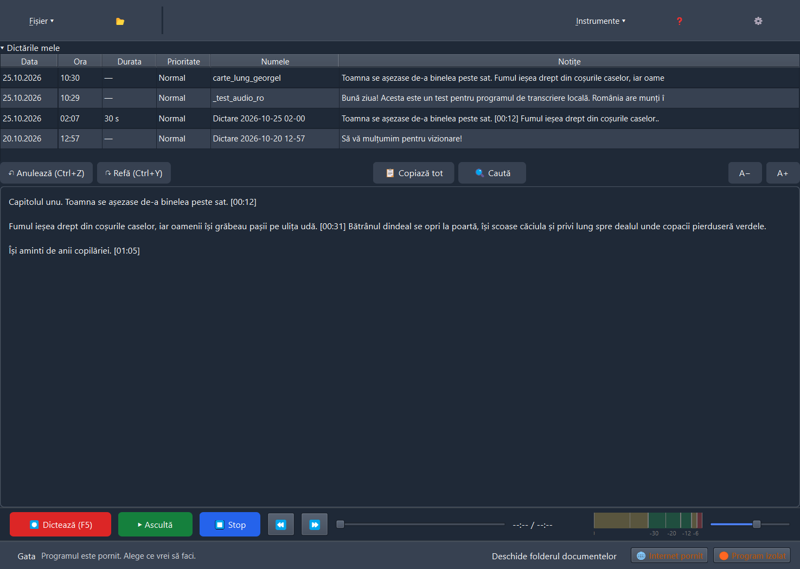
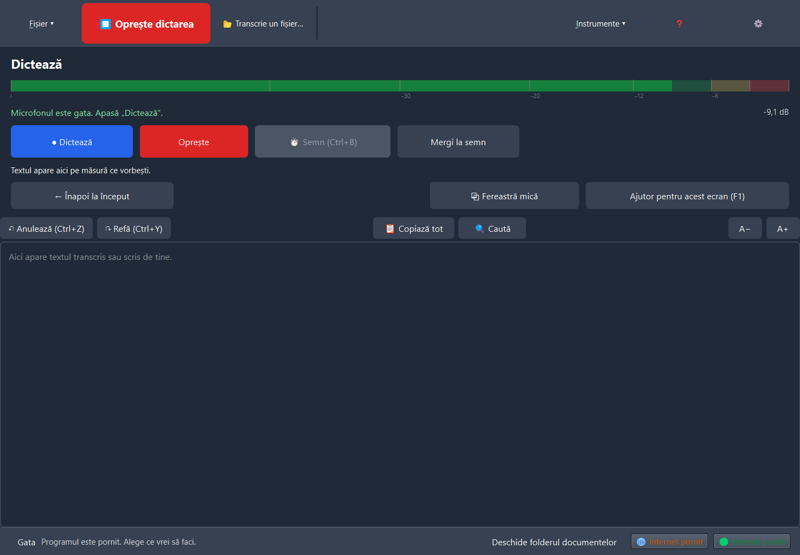
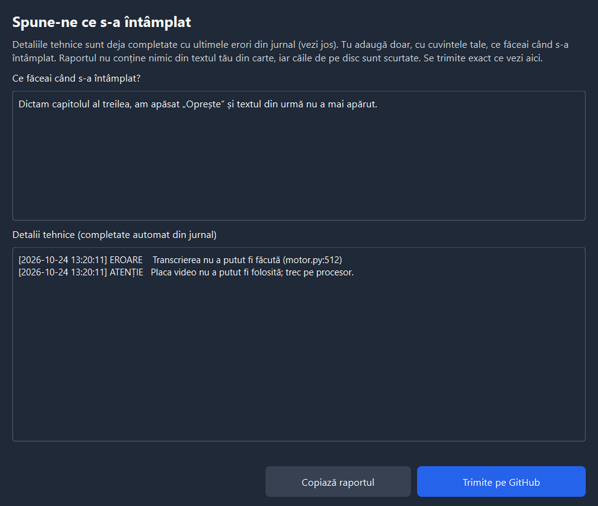
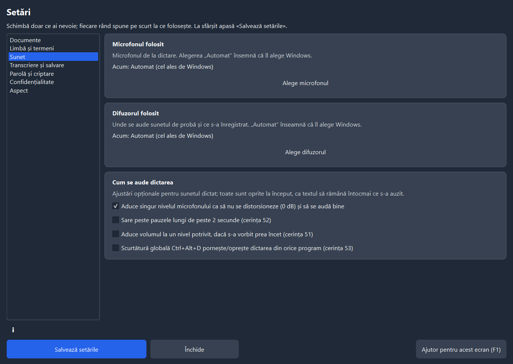

<!-- D&TED · Dictare și transcriere locală în limba română -->

<div align="center">



# 🎙️ D&amp;ED · Dictare &amp; Transcriere Express Digital

### Vorbește românește. Programul scrie. Totul pe calculatorul tău.

Dictare live și transcriere de fișiere audio cu **Whisper** optimizat pentru română —
fără internet, fără cont, fără cloud. Făcut pentru **text lung de carte**.

[](https://github.com/Hermeneuticus-of-things/dted/releases)
[](https://github.com/Hermeneuticus-of-things/dted/actions)


### Instalează dintr-o singură comandă (PowerShell):

```powershell
irm https://raw.githubusercontent.com/Hermeneuticus-of-things/dted/main/dted-bootstrap.ps1 | iex
```

<sub>descarcă kitul complet (inclusiv modelul), verifică SHA-256 pe fiecare bucată, instalează fără administrator</sub>

[📥 Instalare](#-instalare) · [✨ Funcții](#-funcții) · [🎯 Acuratețe](#-acuratețe-măsurată) · [🔒 Confidențialitate](#-confidențialitate) · [🗺️ Roadmap](#️-ce-urmează-roadmap)

</div>

---

## ✨ Funcții

### 🎤 Dictare pentru text de carte
Apasă butonul **roșu** (sau F5) și vorbește — textul apare **în timp ce vorbești**, direct în editorul mare. Semnele `[mm:ss]` (Ctrl+B) marchează locurile importante. Fără pagini separate: o singură fereastră de lucru, ca la Express Dictate.

### ▶ Ascultă și corectează
Pune cursorul lângă un semn și apasă **F9** (sau Ctrl+R): transportul de jos redă **exact bucata respectivă** — Play verde, Stop albastru, derulare, poziție `01:23 / 05:40` și volum.

<div align="center">

</div>

### 🎚 Microfonul se reglează singur
Vumetru profesional **cu gradații în dB** — 0 dB înseamnă distorsiune. Programul **aduce automat volumul microfonului** în zona bună: nu prea tare (să nu taie), nu prea încet (să se audă).

### 🧠 Se învață din corecturile tale
Corectezi un cuvânt scris greșit → perechea se salvează singură și **se repară automat la următoarele transcrieri**. Dicționarul se poate exporta și importa (TXT/CSV/JSON).

### 📋 Gestionarea dictărilor
Lista „Dictările mele” arată tot: **Data, Ora, Durata, Prioritatea, Numele și primele cuvinte** din text. Clic dreapta pe o dictare: **Deschide**, **Redenumește (F2)**, **Șterge (Ctrl+Delete)** — merge la Coșul de reciclare, nu dispare definitiv.

### 🎙️ Activare vocală (opțional)
Din Setări → Sunet: programul **pornește singur dictarea când începi să vorbești** (prag reglabil în dB, ca „Voice Activate Level” din Express Dictate). Oprești cu F5 și se rearmează singur.

### 🧹 Curățenie automată
Bâlbâielile și buclele („nu, nu, nu") se strâng singure; dublările firești rămân.

### 📂 Transcriere de fișiere, în rând
Trage mai multe fișiere audio (MP3/WAV/M4A/OGG/FLAC/Opus) deodată — se transcriu **unul după altul**, iar cele deja transcrise se sar singure.

### 💾 Export complet · 🔐 Criptare cu parolă
Salvează în DOCX, ODT, TXT, RTF, HTML, SRT, VTT sau PDF. La cerere, documentele se **criptează AES-256** cu parolă (cea implicită: „Dictare" — schimb-o din Setări).

### 🛡 Confidențialitate pentru text sensibil
Programul **nu trimite nimic pe internet**. Te avertizează când internetul e pornit, poate bloca căile de ieșire în timpul dictării și îți arată mereu starea.

### 🐞 Găsești o problemă? Un singur clic
La orice eroare apare discret „⚠ Trimite raportul?" — fereastra vine **deja completată** cu detaliile tehnice din jurnal; tu adaugi doar ce făceai. Se trimite direct aici, pe GitHub — **fără text din carte, fără căi personale**.

<div align="center">

</div>

---

## 🎯 Acuratețe măsurată

Mostre: pasaj de **carte de 30 s** + propoziții scurte, voce românească sintetizată natural ([XTTS-v2-ro](https://huggingface.co/eduardem/xtts-v2-romanian-v2)), plus o înregistrare umană. WER = procent de cuvinte greșite (mai mic = mai bine). Măsurătorile complete: [`docs/MODELE_ROMANA.md`](docs/MODELE_ROMANA.md).

| Model | Carte (30 s) | Total | Viteză (30 s audio) | Dimensiune |
|---|---|---|---|---|
| **[eek whisper-turbo-ro](https://huggingface.co/eek/whisper-turbo-ro-en)** — **implicit** ✔ | **5,4%** | **5,8%** | 1,3 s | 788 MB |
| Whisper large-v3-turbo (standard) | 12,2% | 10,9% | 1,6 s | 1,6 GB |
| Fine-tunat RO (TransferRapid) | 47,3% ⚠️ | 37,0% | 0,7 s | 1,6 GB |

<sub>⚠️ fine-tunatul pe Common Voice taie textul lung — inutil pentru cărți. Modelul bun se alege singur; îl poți schimba din Setări → „Cum transcrie”.</sub>

Pe placă video NVIDIA compatibilă transcrierea rulează de **~20× mai rapid decât în timp real**; fără placă video, merge pe procesor.

---

## 📥 Instalare (versiunea v0.6.2)

### Varianta 1 — Bootstrap (o singură comandă PowerShell, recomandat)

Deschide **PowerShell** (Start → „powershell” → Enter) și lipește:

```powershell
irm https://raw.githubusercontent.com/Hermeneuticus-of-things/dted/main/dted-bootstrap.ps1 | iex
```

### Varianta 2 — Kit instalator descărcat manual (`Setup.DTED-0.6.2.exe`)

Ia [ultima versiune (**v0.6.2**)](https://github.com/Hermeneuticus-of-things/dted/releases/tag/v0.6.2): `Setup.DTED-0.6.2.exe` + `Setup.DTED-0.6.2-1.bin` + `SHA256SUMS.txt`, pune-le **în același folder**, apoi dublu clic pe `Setup.DTED-0.6.2.exe`. Modelul de transcriere și bibliotecile CUDA sunt **incluse** — instalarea merge 100% offline și fără drepturi de administrator.

### Varianta 3 — Actualizare rapidă din program / Portabil (`program-0.6.2.zip`)

Dacă ai deja D&TED instalat, apasă butonul **📦 Actualizări** din bara de sus (sau **⚙ Setări → Actualizări**) → **Caută actualizări (internet)**: programul descarcă doar arhiva ușoară [`program-0.6.2.zip`](https://github.com/Hermeneuticus-of-things/dted/releases/download/v0.6.2/program-0.6.2.zip) (~1,1 MB), îi verifică amprenta SHA-256, păstrează copia de siguranță a versiunii vechi și repornește la zi.

<details>
<summary><b>Verificarea sumelor SHA-256 (opțional, recomandat)</b></summary>

```powershell
$fisiere = @("Setup.DTED-0.6.2.exe", "Setup.DTED-0.6.2-1.bin", "program-0.6.2.zip")
foreach ($nume in $fisiere) {
    if (-not (Test-Path ".\$nume")) { continue }
    $rand = Get-Content .\SHA256SUMS.txt | Where-Object { $_ -match "\s+$([regex]::Escape($nume))$" }
    $asteptat = ($rand -split '\s+')[0].ToUpper()
    $real = (Get-FileHash ".\$nume" -Algorithm SHA256).Hash.ToUpper()
    if ($real -ne $asteptat) { throw "Amprentă greșită pentru $nume" }
    "OK      $nume"
}
```

</details>

**Cerințe:** Windows 10/11 pe 64 de biți · 8 GB RAM recomandat · ~4 GB pe disc.

---

## 🔒 Confidențialitate

| | |
|---|---|
| ✅ Transcrierea rulează **100% local** (procesor sau placa ta video) | 🚫 Sunetul și textul nu pleacă niciodată pe internet |
| ✅ Actualizările se caută **doar când apeși butonul** | 🚫 Fără conturi, fără telemetrie, fără cloud |
| ✅ Raportarea problemelor arată exact ce trimite | 🚫 Rapoartele nu conțin text din carte, parole sau căi personale |

---

## 🧪 Cod sursă și teste

```bash
git clone https://github.com/Hermeneuticus-of-things/dted.git
cd dted
python -m venv .venv && .venv\Scripts\pip install -r requirements.txt pytest
.venv\Scripts\python -m pytest -q .\teste      # 115 teste
.venv\Scripts\python pornire.py                # pornește aplicația
```

**115 teste automate** · CI pe **Windows și Linux** la fiecare commit · probe de transcriere reale pe placă video. Nucleul merge și pe Linux — vezi [LINUX.md](LINUX.md). Aplicația poate fi folosită și **din alte programe**, în mod serviciu (`DTED.exe --serviciu`).

<div align="center">

</div>

---

## 🗺️ Ce urmează (roadmap)

*Rămas după v0.6.2 — dictarea pentru cărți e completă:*

- [x] ~~**Instalatorul online (V2), fără administrator**~~ — **gata**: comanda `irm … | iex` de sus face exact asta (descarcă versiunea fixă, verifică SHA-256, instalează per-utilizator)
- [x] ~~**Streaming cuvânt cu cuvânt și chunking adaptiv VAD la dictare**~~ — **gata (v0.6.2)**: latență minimă (bucăți adaptive 0,8–2,0 s tăiate la pauzele naturale de respirație), eliminat blocajele la dictare continuă non-stop și afișare fluidă cuvânt cu cuvânt în editor
- [x] ~~**Afișare live cuvânt cu cuvânt la dictare + rulare fără cereri UAC**~~ — **gata (v0.6.2)**: cuvintele apar pe ecran pe măsură ce sunt rostite, iar izolarea de rețea în Mod 2 lucrează direct în proces fără UAC
- [x] ~~**Recuperarea sunetului și a textului la cădere (cerința 61)**~~ — **gata (v0.6.2)**: atât textul, cât și fișierul `.wav` se salvează pe bucăți și se recuperează la repornire
- [x] ~~**Reorganizare UI/UX fără suprapuneri + Actualizări din GitHub**~~ — **gata (v0.6.2)**: ecrane secundare cu bară de întoarcere la editor, Setări fără rânduri înghesuite și update rapid prin `program-0.6.2.zip`
- [ ] **Modelul „pentru toți utilizatorii"** — instalare partajată (cere drepturi de administrator o singură dată)
- [ ] **Editare audio** — marcarea și ștergerea unor porțiuni din înregistrare (Ctrl+Shift+S/E/D, ca la Express Dictate)
- [ ] **Limbi suplimentare** — dictarea și în alte limbi (engleză prima, apoi cele cu model bun local); româna rămâne implicită și forțată ca astăzi
- [ ] **Coloana Prioritate reală** — marchează o dictare „Urgentă” din listă (acasă momentan toate sunt „Normal”)
- [ ] **Alte modele noi pentru română** — pe măsură ce apar, se adaugă ca opțiune în Setări

---

<div align="center">

**[⬇ Toate versiunile](https://github.com/Hermeneuticus-of-things/dted/releases)** · **[🐞 Problema? Raportează direct din program](https://github.com/Hermeneuticus-of-things/dted/issues)**

Cu 🎙 și 🤍 pentru limba română · [modele și măsurători](docs/MODELE_ROMANA.md)

<sub>D&amp;ED v0.6.2-beta · Whisper large-v3-turbo (eek, optimizat RO) · CTranslate2 · PySide6 · Inno Setup</sub>

</div>
