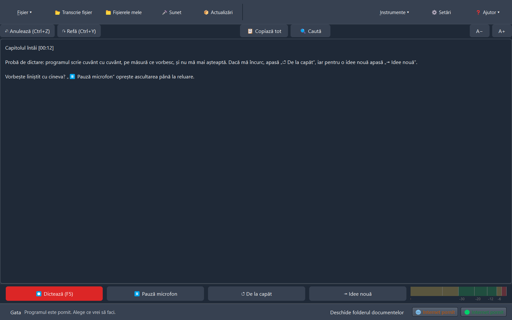
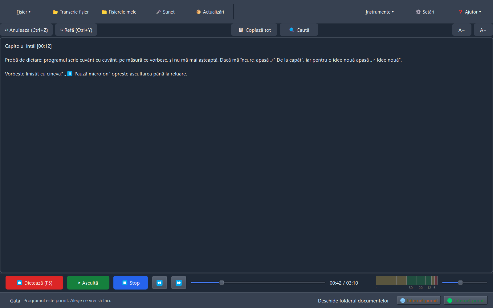
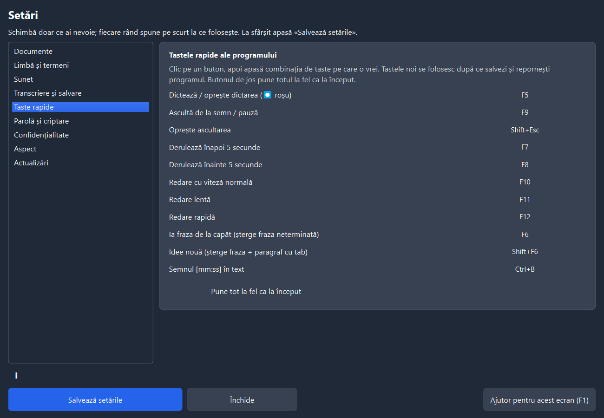

<!-- D&TED · Dictare și transcriere locală în limba română -->

<div align="center">



# 🎙️ D&amp;ED · Dictare &amp; Transcriere Express Digital

### Vorbește românește. Programul scrie. Totul pe calculatorul tău.

Dictare live și transcriere de fișiere audio cu **Whisper** optimizat pentru română —
fără internet, fără cont, fără cloud. Făcut pentru **text lung de carte**.

[](https://github.com/Hermeneuticus-of-things/dted/releases)
[](https://github.com/Hermeneuticus-of-things/dted/actions)


### Instalează dintr-o singură comandă (PowerShell):

```powershell
irm https://raw.githubusercontent.com/Hermeneuticus-of-things/dted/main/dted-bootstrap.ps1 | iex
```

<sub>descarcă kitul complet (inclusiv modelul), verifică SHA-256 pe fiecare bucată, instalează fără administrator</sub>

[📥 Instalare](#-instalare) · [✨ Funcții](#-funcții) · [🎯 Acuratețe](#-acuratețe-măsurată) · [🔒 Confidențialitate](#-confidențialitate) · [🗺️ Roadmap](#️-ce-urmează-roadmap)

</div>

---

## ⬇️ DESCARCĂ D&TED — apasă pe un link și gata

**Folosești Windows?** Ai nevoie de UNUL din cele trei rânduri de mai jos, nu de toate:

| Vrei… | Apasă aici | Apoi… |
|---|---|---|
| **Cel mai simplu: instalează** | **[⬇️ DESCARCĂ SETUP.DTED-0.6.3.EXE](https://github.com/Hermeneuticus-of-things/dted/releases/download/v0.6.3/Setup.DTED-0.6.3.exe)** | aștepți să se descarce (~1,84 GB), dublu clic pe el → „Next” → „Instalează”. Gata. |
| **Fără instalare, de pe stick** | **[⬇️ DESCARCĂ PORTABIL-DTED-0.6.3.ZIP](https://github.com/Hermeneuticus-of-things/dted/releases/download/v0.6.3/portabil-DTED-0.6.3.zip)** | click dreapta pe zip → „Dezarhivează” → intri în folderul `DTED` → dublu clic pe `DTED.exe` |
| **Totul automat, cu o comandă** | copiază în PowerShell: `irm https://raw.githubusercontent.com/Hermeneuticus-of-things/dted/main/dted-bootstrap.ps1 \| iex` | scriptul descarcă singur kitul și îl verifică, apoi pornește instalatorul |

**Ai deja D&TED pe calculator?** Nu descarci nimic: deschide programul → butonul **📦 Actualizări** (sus) → **Caută actualizări (internet)** → confirmă.

**Folosești Linux?** → **[⬇️ DESCARCĂ DTED PENTRU LINUX](https://github.com/Hermeneuticus-of-things/dted/releases/download/v0.6.3/dted-0.6.3-linux.tar.gz)**, apoi în terminal: `tar -xzf dted-0.6.3-linux.tar.gz` și `./install.sh`.

**Nu ești sigur ce ai descărcat?** Fiecare fișier are suma SHA-256 în [SHA256SUMS.txt](https://github.com/Hermeneuticus-of-things/dted/releases/download/v0.6.3/SHA256SUMS.txt); verificarea pas cu pas e mai jos, la „Instalare”.

<sub>modelul de transcriere e deja în kit (la portabil îl are); nimic nu se descarcă la prima pornire, fără conturi, fără administrator</sub>

---

## ✨ Funcții

### 🎤 Dictare pentru text de carte
Apasă butonul **roșu** (sau F5) și vorbește — textul apare **în timp ce vorbești**, direct în editorul mare. Semnele `[mm:ss]` (Ctrl+B) marchează locurile importante. Fără pagini separate: o singură fereastră de lucru, ca la Express Dictate.

### ▶ Ascultă și corectează
Pune cursorul lângă un semn și apasă **F9** (sau Ctrl+R): transportul de jos redă **exact bucata respectivă** — Play verde, Stop albastru, derulare, poziție `01:23 / 05:40` și volum.

<div align="center">

</div>

### 🎚 Microfonul se reglează singur
Vumetru profesional **cu gradații în dB** — 0 dB înseamnă distorsiune. Programul **aduce automat volumul microfonului** în zona bună: nu prea tare (să nu taie), nu prea încet (să se audă).

### ⌨ Tastele tale, cum vrei tu

Din **Setări → „Taste rapide”** îți alegi singur tastele pentru: dictează, ascultă, derulare,
viteze, semnul [mm:ss], „De la capăt” și „Idee nouă”. Clic pe buton, apeși combinația, salvezi —
iar „Pune tot la fel ca la început” le readuce pe cele din fabrică.

<div align="center">

</div>

### 🧠 Se învață din corecturile tale
Corectezi un cuvânt scris greșit → perechea se salvează singură și **se repară automat la următoarele transcrieri**. Dicționarul se poate exporta și importa (TXT/CSV/JSON).

### 📋 Gestionarea dictărilor
Lista „Dictările mele” arată tot: **Data, Ora, Durata, Prioritatea, Numele și primele cuvinte** din text. Clic dreapta pe o dictare: **Deschide**, **Redenumește (F2)**, **Șterge (Ctrl+Delete)** — merge la Coșul de reciclare, nu dispare definitiv.

### 🎙️ Activare vocală (opțional)
Din Setări → Sunet: programul **pornește singur dictarea când începi să vorbești** (prag reglabil în dB, ca „Voice Activate Level” din Express Dictate). Oprești cu F5 și se rearmează singur.

### 🧹 Curățenie automată
Bâlbâielile și buclele („nu, nu, nu") se strâng singure; dublările firești rămân.

### 📂 Transcriere de fișiere, în rând
Trage mai multe fișiere audio (MP3/WAV/M4A/OGG/FLAC/Opus) deodată — se transcriu **unul după altul**, iar cele deja transcrise se sar singure.

### 💾 Export complet · 🔐 Criptare cu parolă
Salvează în DOCX, ODT, TXT, RTF, HTML, SRT, VTT sau PDF. La cerere, documentele se **criptează AES-256** cu parolă (cea implicită: „Dictare" — schimb-o din Setări).

### 🛡 Confidențialitate pentru text sensibil
Programul **nu trimite nimic pe internet**. Te avertizează când internetul e pornit, poate bloca căile de ieșire în timpul dictării și îți arată mereu starea.

### 🐞 Găsești o problemă? Un singur clic
La orice eroare apare discret „⚠ Trimite raportul?" — fereastra vine **deja completată** cu detaliile tehnice din jurnal; tu adaugi doar ce făceai. Se trimite direct aici, pe GitHub — **fără text din carte, fără căi personale**.

<div align="center">

</div>

---

## 🎯 Acuratețe măsurată

Mostre: pasaj de **carte de 30 s** + propoziții scurte, voce românească sintetizată natural ([XTTS-v2-ro](https://huggingface.co/eduardem/xtts-v2-romanian-v2)), plus o înregistrare umană. WER = procent de cuvinte greșite (mai mic = mai bine). Măsurătorile complete: [`docs/MODELE_ROMANA.md`](docs/MODELE_ROMANA.md).

| Model | Carte (30 s) | Total | Viteză (30 s audio) | Dimensiune |
|---|---|---|---|---|
| **[eek whisper-turbo-ro](https://huggingface.co/eek/whisper-turbo-ro-en)** — **implicit** ✔ | **5,4%** | **5,8%** | 1,3 s | 788 MB |
| Whisper large-v3-turbo (standard) | 12,2% | 10,9% | 1,6 s | 1,6 GB |
| Fine-tunat RO (TransferRapid) | 47,3% ⚠️ | 37,0% | 0,7 s | 1,6 GB |

<sub>⚠️ fine-tunatul pe Common Voice taie textul lung — inutil pentru cărți. Modelul bun se alege singur; îl poți schimba din Setări → „Cum transcrie”.</sub>

Pe placă video NVIDIA compatibilă transcrierea rulează de **~20× mai rapid decât în timp real**; fără placă video, merge pe procesor.

---

## 📥 Instalare (versiunea v0.6.3) — alege varianta care ți se potrivește

| Varianta | Pentru cine | Ce descarci | Internet la instalare? |
|---|---|---|---|
| **A. Kit pe stick (offline)** | vrei să instalezi și pe alt calculator, fără internet; text sensibil | `Setup.DTED-0.6.3.exe` (un singur fișier, ~1,85 GB) | **NU** — totul e inclus (model + CUDA) |
| **B. Bootstrap (o comandă)** | ai internet, vrei totul automat | nimic — o comandă PowerShell | DA (descarcă kitul și îl verifică) |
| **C. Portabil (fără instalare)** | vrei să-l pornești direct de pe stick, fără instalare | `portabil-DTED-0.6.3.zip` (~1,3 GB) | NU (doar CUDA, dacă ai placă video, din program) |
| **D. Actualizare din program** | ai deja D&TED instalat | nimic — un buton din program | doar arhiva mică de ~1,2 MB |
| **Linux** | calculator cu Linux (x86_64) | `dted-0.6.3-linux.tar.gz` | DA (descarcă modelul la instalare) |

> **Toate fișierele sunt aici:** [github.com/Hermeneuticus-of-things/dted/releases/tag/v0.6.3](https://github.com/Hermeneuticus-of-things/dted/releases/tag/v0.6.3) (secțiunea „Assets”), cu sumele SHA-256 în `SHA256SUMS.txt`.

### A. Kit pe stick — instalare offline, pe orice Windows

1. Descarcă **`Setup.DTED-0.6.3.exe`** din release (linkul de mai sus) — un singur fișier.
2. Pune-l pe stick, apoi pe calculatorul unde vrei programul: dublu clic pe el → Next → Instalează.
   - Nu cere administrator; modelul de transcriere (~800 MB) și bibliotecile plăcii video CUDA sunt **în kit** — nu se descarcă nimic.
   - Wizard-ul îți arată pagina **„Ce știe să facă D&TED”** (o poți citi cât se instalează) și **verificarea calculatorului** (CPU, RAM, disc, placă video + VRAM).

### B. Bootstrap — totul automat, cu o singură comandă

1. Deschide **PowerShell** (Start → scrii „powershell” → Enter).
2. Lipește rândul de mai jos și apasă Enter:

```powershell
irm https://raw.githubusercontent.com/Hermeneuticus-of-things/dted/main/dted-bootstrap.ps1 | iex
```

3. Scriptul descarcă kitul de la **versiunea fixă v0.6.3**, verifică **SHA-256** pe fiecare bucată
   (amprenta greșită = oprire și refuz, nu instalează nimic) și pornește instalatorul grafic.
   Scriptul poate fi citit înainte: [dted-bootstrap.ps1](https://github.com/Hermeneuticus-of-things/dted/blob/main/dted-bootstrap.ps1).

### C. Portabil — pornești direct, fără instalare

1. Descarcă **`portabil-DTED-0.6.3.zip`** din release.
2. Click dreapta pe el → **„Extract All…” / „Dezarhivează”** → intri în folderul `DTED`.
3. Dublu clic pe **`DTED.exe`**. Gata — programul pornește. Nu se scrie nimic în Windows, nu cere
   administrator; ștergi folderul și programul dispare complet. Merge perfect de pe stick.
   - Pe calculator **cu placă video NVIDIA**, deschide programul → ⚙ Setări → „Instalare și actualizări” →
     butonul „Descarcă bibliotecile pentru placa video” — și transcrierea devine de ~20× mai rapidă.
   - Fără placă video merge pe procesor, cu aceeași calitate, doar mai încet.

### D. Ai deja D&TED? Actualizezi din program, cu un buton

Deschide programul → **📦 Actualizări** (bara de sus) → **Caută actualizări (internet)** → îți arată
„program: 0.6.2 → 0.6.3” → confirmi → programul descarcă arhiva mică
[`program-0.6.3.zip`](https://github.com/Hermeneuticus-of-things/dted/releases/download/v0.6.3/program-0.6.3.zip),
verifică amprenta, păstrează copia versiunii vechi și, după repornire, **rulează chiar versiunea nouă**.
Butonul „Revino la versiunea anterioară” te aduce înapoi oricând.

### Linux (x86_64) — cu scriptul `install.sh`

Pe Linux nu există bootstrap `irm | iex` (acela e pentru Windows). Instalarea:

1. Descarcă **[`dted-0.6.3-linux.tar.gz`](https://github.com/Hermeneuticus-of-things/dted/releases/download/v0.6.3/dted-0.6.3-linux.tar.gz)** din release.
2. În terminal, în folderul unde l-ai descărcat:
   ```bash
   tar -xzf dted-0.6.3-linux.tar.gz
   ./install.sh
   ```
3. Scriptul își face mediu Python propriu (fără administrator), pune comanda `dted` în `~/.local/bin`,
   adaugă scurtătură în meniu și descarcă modelul cu verificare SHA-256; cu placă NVIDIA adaugă și CUDA.
   Detalii și limite (criptarea fișierelor e doar Windows): [LINUX.md](LINUX.md).

**Cerințe:** Windows 10/11 pe 64 de biți · 8 GB RAM recomandat · ~4 GB pe disc.

---

## 🔒 Confidențialitate

| | |
|---|---|
| ✅ Transcrierea rulează **100% local** (procesor sau placa ta video) | 🚫 Sunetul și textul nu pleacă niciodată pe internet |
| ✅ Actualizările se caută **doar când apeși butonul** | 🚫 Fără conturi, fără telemetrie, fără cloud |
| ✅ Raportarea problemelor arată exact ce trimite | 🚫 Rapoartele nu conțin text din carte, parole sau căi personale |

---

## 🧪 Cod sursă și teste

```bash
git clone https://github.com/Hermeneuticus-of-things/dted.git
cd dted
python -m venv .venv && .venv\Scripts\pip install -r requirements.txt pytest
.venv\Scripts\python -m pytest -q .\teste      # 115 teste
.venv\Scripts\python pornire.py                # pornește aplicația
```

**115 teste automate** · CI pe **Windows și Linux** la fiecare commit · probe de transcriere reale pe placă video. Nucleul merge și pe Linux — vezi [LINUX.md](LINUX.md). Aplicația poate fi folosită și **din alte programe**, în mod serviciu (`DTED.exe --serviciu`).

<div align="center">

</div>

---

## 🆕 Ce e nou în v0.6.3

- **Dictarea scrie pe măsură ce vorbești, cuvânt cu cuvânt** — cuvintele apar live (afisare provizorie) cât timp rostești, iar bucata finală le confirmă curat; nu mai aștepți după „bucăți mari" de fraze.
- **Dictarea nu se mai blochează** — transcrierea rulează pe un fir separat: captura microfonului continuă neîntreruptă cât timp modelul lucrează, deci nu se mai adună întârziere la dictare non-stop.
- **Prima dictare pornește instant** — modelul se încarcă singur în fundal imediat după pornirea programului (nu mai aștepți zeci de secunde la prima dictare).
- **Bucăți de dictare mai rapide** — la dictare modelul folosește calea rapidă (o singură ipoteză, fără timpii de cuvinte); la transcrierea de fișiere rămâne varianta de calitate maximă.
- **⏸ Pauză microfon** — buton nou în bara de transport de jos (și în fereastra mică): vorbești cu cineva, programul nu scrie nimic; apasă din nou și continui exact de unde ai rămas.
- **↺ De la capăt (F6) și ⇥ Idee nouă (Shift+F6)** — două butoane noi în bara de transport: șterg fraza dictată neterminată ca să o redictezi, respectiv o șterg și deschid un paragraf nou cu tab înainte (idee nouă).
- **Taste rapide configurabile** — Setări → „Taste rapide”: îți alegi singur tastele pentru dictează, ascultă, derulare, viteze, semn, de la capăt, idee nouă; cu un clic reveni la valorile din fabrică.
- **Actualizările din program chiar intră în vigoare** — reparat: la aplicația instalată, codul descărcat cu „Caută actualizări" se încărca greșit la repornire; acum versiunea nouă rulează efectiv.
- **Instalator mai prietenos** — pagină nouă în wizard: „Ce știe să facă D&TED" (cum dictezi, cum merge cel mai bine, ce exportă); verificarea hardware arată acum și **VRAM-ul plăcii video** (minim 6 GB pentru GPU, altfel CPU).
- **Curățenie** — scoase din repo fișierele vechi (.bak, iconițe înlocuite, instalatoare istorice) și dublura de meniu „Verifică programul" (rămâne doar în Instrumente).

## 🗺️ Ce urmează (roadmap)

*Rămas după v0.6.3 — dictarea pentru cărți e completă:*

- [x] ~~**Instalatorul online (V2), fără administrator**~~ — **gata**: comanda `irm … | iex` de sus face exact asta (descarcă versiunea fixă, verifică SHA-256, instalează per-utilizator)
- [x] ~~**Streaming cuvânt cu cuvânt și chunking adaptiv VAD la dictare**~~ — **gata (v0.6.2)**: latență minimă (bucăți adaptive 0,8–2,0 s tăiate la pauzele naturale de respirație), eliminat blocajele la dictare continuă non-stop și afișare fluidă cuvânt cu cuvânt în editor
- [x] ~~**Afișare live cuvânt cu cuvânt la dictare + rulare fără cereri UAC**~~ — **gata (v0.6.2)**: cuvintele apar pe ecran pe măsură ce sunt rostite, iar izolarea de rețea în Mod 2 lucrează direct în proces fără UAC
- [x] ~~**Recuperarea sunetului și a textului la cădere (cerința 61)**~~ — **gata (v0.6.2)**: atât textul, cât și fișierul `.wav` se salvează pe bucăți și se recuperează la repornire
- [x] ~~**Reorganizare UI/UX fără suprapuneri + Actualizări din GitHub**~~ — **gata (v0.6.2)**: ecrane secundare cu bară de întoarcere la editor, Setări fără rânduri înghesuite și update rapid prin `program-0.6.3.zip`
- [ ] **Modelul „pentru toți utilizatorii"** — instalare partajată (cere drepturi de administrator o singură dată)
- [ ] **Editare audio** — marcarea și ștergerea unor porțiuni din înregistrare (Ctrl+Shift+S/E/D, ca la Express Dictate)
- [ ] **Limbi suplimentare** — dictarea și în alte limbi (engleză prima, apoi cele cu model bun local); româna rămâne implicită și forțată ca astăzi
- [ ] **Coloana Prioritate reală** — marchează o dictare „Urgentă” din listă (acasă momentan toate sunt „Normal”)
- [ ] **Alte modele noi pentru română** — pe măsură ce apar, se adaugă ca opțiune în Setări

---

<div align="center">

**[⬇ Toate versiunile](https://github.com/Hermeneuticus-of-things/dted/releases)** · **[🐞 Problema? Raportează direct din program](https://github.com/Hermeneuticus-of-things/dted/issues)**

Cu 🎙 și 🤍 pentru limba română · [modele și măsurători](docs/MODELE_ROMANA.md)

<sub>D&amp;ED v0.6.3-beta · Whisper large-v3-turbo (eek, optimizat RO) · CTranslate2 · PySide6 · Inno Setup</sub>

</div>
