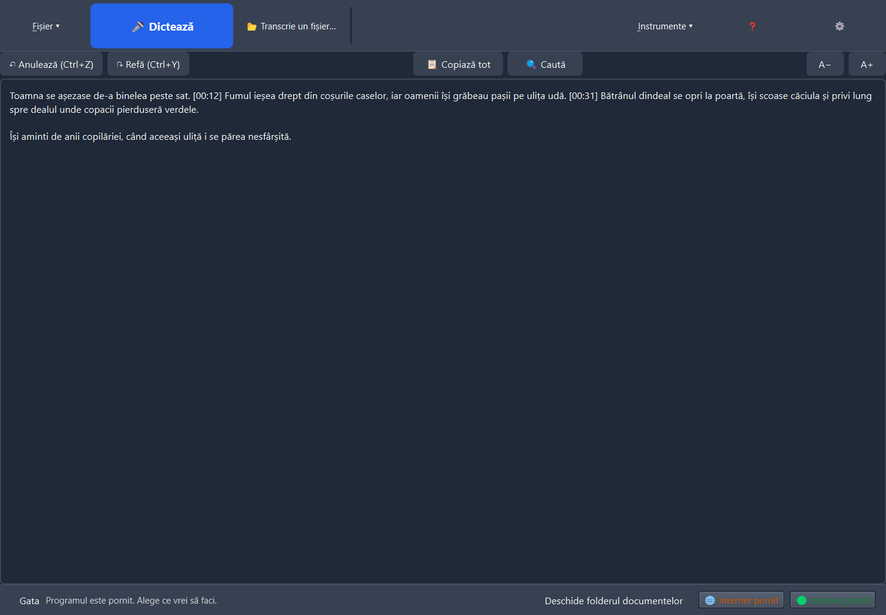
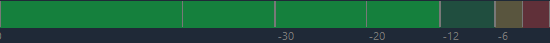

<!-- D&TED · Dictare și transcriere locală în limba română -->

<div align="center">



# 🎙️ D&amp;TED

**Dictare și transcriere în limba română, direct pe calculatorul tău.**

Vorbești la microfon sau alegi un fișier audio. Revizuiești textul, îl corectezi ascultând, îl salvezi.

[](https://github.com/Hermeneuticus-of-things/dted/releases)
[](https://github.com/Hermeneuticus-of-things/dted/actions)


**Instalare dintr-o singură comandă** (PowerShell):

```powershell
irm https://raw.githubusercontent.com/Hermeneuticus-of-things/dted/main/dted-bootstrap.ps1 | iex
```

[Instalare](#-instalare) · [Funcții](#-funcții) · [Confidențialitate](#-date-și-confidențialitate) · [Raportează o problemă](#-ai-găsit-o-problemă) · [Ce urmează](#-ce-urmează)

</div>

---

## ✨ Funcții

| | |
|---|---|
| 🎤 **Dictare live** | Textul apare în timp ce vorbești, pe bucăți de 4 s; semne `[mm:ss]` marcate cu Ctrl+B |
| ▶ **Ascultă și corectează** | Ctrl+R pornește redarea exact de la semnul de lângă cursor; pauză, oprire, poziție în bara de jos |
| 🎚 **Vumetru în dB + auto-volum** | 0 dB = distorsiune; programul aduce singur nivelul microfonului ca să nu se taie sunetul |
| 🧹 **Curățare repetiții** | „nu, nu, nu" devine „nu" (bâlbâială sau buclă); dublările firești rămân |
| 📚 **Dicționar de corecturi** | Corectezi un cuvânt o dată → se repară singur de acum încolo; import/export |
| 📂 **Transcriere fișiere** | MP3/WAV/M4A/OGG/FLAC/Opus, mai multe deodată (coadă); cele deja transcrise se sar |
| 💾 **Export** | DOCX, ODT, TXT, RTF, HTML, SRT, VTT + PDF |
| 🔐 **Criptare cu parolă** | AES-256; parola implicită „Dictare", schimbabilă |
| 🛡 **Confidențialitate** | Avertizări la internet pornit; blocare opțională a căilor de ieșire în timpul dictării |
| 🐞 **Raportare integrată** | Erorile din jurnal pleacă direct pe GitHub, fără text din carte și fără căi personale |

<div align="center">


</div>

## 📥 Instalare

<div align="center">

### Dintr-o singură comandă (recomandat)

```powershell
irm https://raw.githubusercontent.com/Hermeneuticus-of-things/dted/main/dted-bootstrap.ps1 | iex
```

*descarcă kitul de la versiunea fixă, verifică SHA-256 pentru fiecare bucată (refuză la sumă greșită), pornește instalatorul — fără administrator*

</div>

<details>
<summary><b>Sau descarcă manual kitul</b></summary>

Descarcă [kitul offline](https://github.com/Hermeneuticus-of-things/dted/releases) — `Setup.DTED-*.exe` + bucățile `.bin` + `SHA256SUMS.txt`.

1. Descarcă **toate fișierele** kitului în **același folder** (`.bin`-urile conțin programul: GitHub nu acceptă fișiere peste 2 GB).
2. (Recomandat) Verifică descărcarea cu `SHA256SUMS.txt`.
3. Dublu clic pe `Setup.DTED-*.exe` → Următor → Instalează. Fără internet: modelul e inclus.

<details>
<summary>Comenzi PowerShell pentru verificare</summary>

```powershell
$fisiere = @("Setup.DTED-0.2.1.exe", "Setup.DTED-0.2.1-1.bin", "Setup.DTED-0.2.1-2.bin")
foreach ($nume in $fisiere) {
    $rand = Get-Content .\SHA256SUMS.txt | Where-Object { $_ -match "\s+$([regex]::Escape($nume))$" }
    $asteptat = ($rand -split '\s+')[0].ToUpper()
    $real = (Get-FileHash ".\$nume" -Algorithm SHA256).Hash.ToUpper()
    if ($real -ne $asteptat) { throw "Amprentă greșită pentru $nume" }
    "OK      $nume"
}
.\Setup.DTED-0.2.1.exe
```

</details>
</details>

## 🔒 Date și confidențialitate

| ✔ Se întâmplă | ✘ NU se întâmplă niciodată |
|---|---|
| Toată transcrierea rulează **local** (CPU sau placa ta video) | Sunetul sau textul **nu pleacă pe internet** |
| Criptarea documentelor cu parola ta (opțional) | Fără conturi, fără telemetrie, fără cloud |
| Actualizările se caută **doar la buton** | Programul nu „sună" acasă singur |

## 📋 Cerințe

- Windows 10/11, 64 de biți · 8 GB RAM recomandat · ~5 GB pe disc (modelul e inclus)
- Placă NVIDIA compatibilă = mai rapid (CUDA); fără ea merge pe procesor

## 🧪 Cod sursă

```bash
git clone https://github.com/Hermeneuticus-of-things/dted.git
cd dted
python -m venv .venv && .venv\Scripts\pip install -r requirements.txt pytest
.venv\Scripts\python -m pytest -q .\teste
.venv\Scripts\python pornire.py
```

<details>
<summary>Mai multe despre teste și verificări</summary>

Pentru verificările grafice PySide6, rulează separat `teste\_smoke_uiqt.py` și `teste\_smoke_principal.py`. `teste\_proba_transcriere.py` folosește modelul real. Modelele de transcriere și măsurătorile de acuratețe pe română: `docs/MODELE_ROMANA.md`.

</details>

## 🐞 Ai găsit o problemă?

Nimic de configurat, niciun cont. Când apare o eroare, jos în fereastră apare discret: **„⚠ A apărut o problemă — trimite raportul?"**. Un clic și fereastra se deschide cu detaliile tehnice deja completate din jurnal; tu scrii doar ce făceai și apeși **„Trimite pe GitHub"**.

<div align="center">

</div>

| ✔ Se trimite | ✘ NU se trimite |
|---|---|
| Descrierea ta + erorile din jurnal (mesaj, loc, oră) | Textul dicat sau transcris (din carte) |
| Versiunea programului și a Windows-ului | Căile complete (sunt scurtate: `%UTILIZATOR%`), parole, chei |

## 🚀 Ce urmează

- 📦 Instalatorul online mic (V2) — descarcă de pe internet doar din listă fixă de versiuni
- 🧠 Modelul [eek/whisper-turbo-ro-en](https://huggingface.co/eek/whisper-turbo-ro-en) — cel mai bun raportat pe română vorbită, ca opțiune (acces restricționat)
- 🎛 Tur de finisaj: scalare pe ecrane mici, ordinea Tab/Narrator, mesaje de eroare unificate

## 🐧 Linux

Nucleul (motor, documente, teste) rulează și pe Linux — vezi [LINUX.md](LINUX.md). Testele de criptare și blocare sar singure pe alte sisteme.

---

<div align="center">

**[⬇ Toate versiunile](https://github.com/Hermeneuticus-of-things/dted/releases)** · **[Cod sursă](https://github.com/Hermeneuticus-of-things/dted)** · **[Probleme și sugestii](https://github.com/Hermeneuticus-of-things/dted/issues)**

Făcut cu 🎙 pentru limba română · procesare 100% locală

</div>
