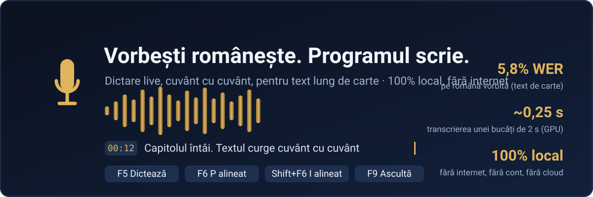
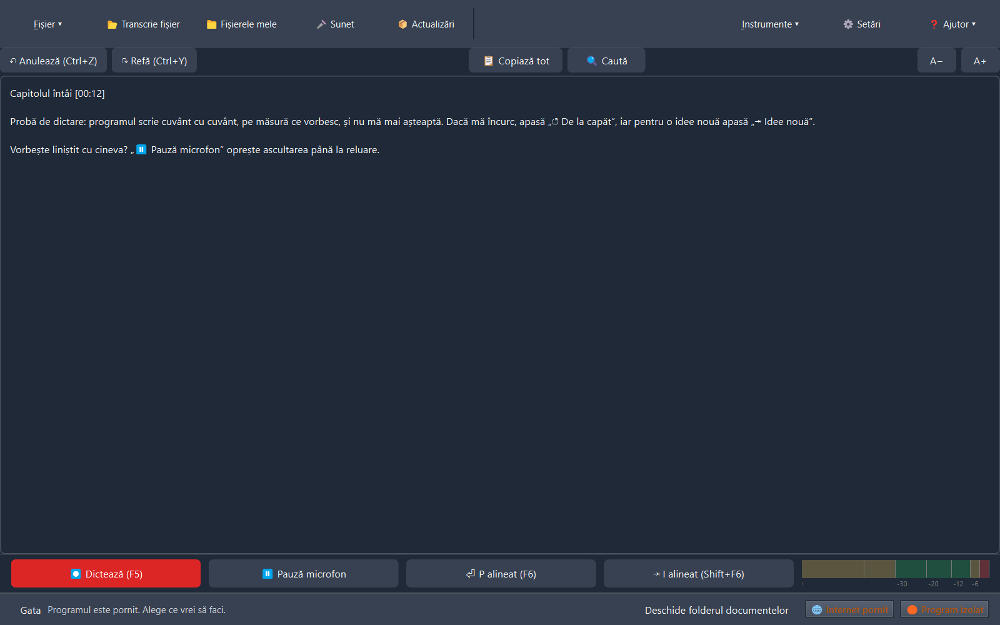
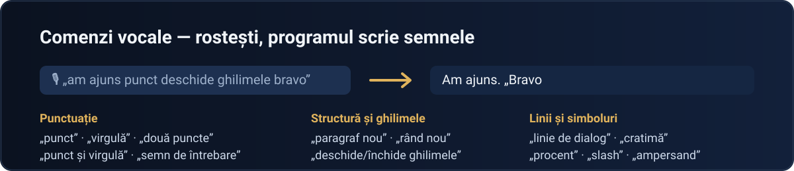
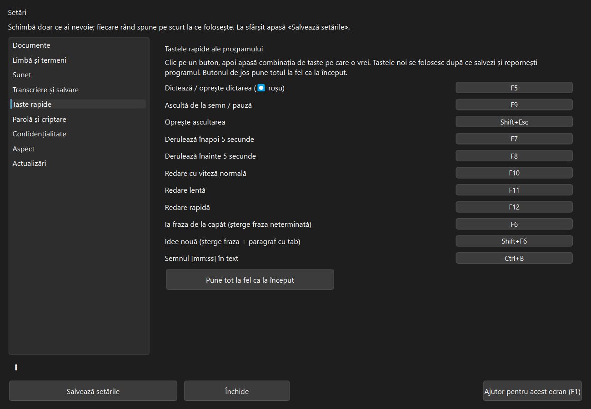

<!-- D&TED · Dictare și transcriere locală în limba română -->

<div align="center">



**Dictare și transcriere în limba română** — pentru text lung de carte, pe calculatorul tău,
fără internet, fără cont, fără cloud.

[](https://github.com/Hermeneuticus-of-things/dted/releases)
[](https://github.com/Hermeneuticus-of-things/dted/actions)


**[⬇️ Descarcă](#-instalare)** · [Ce face](#-ce-este) · [Cum lucrezi](#-cum-lucrezi) · [Întrebări](#-întrebări-frecvente) · [Raportează](#-găsești-o-problemă-raportează-dintrun-clic)

</div>

---

## 🔎 Dovada, pe prima vedere

<div align="center">

</div>

Bara de jos se schimbă cu contextul: la dictare vezi **doar butoanele de dictare**,
când există o înregistrare **doar butoanele de redare** — nimic care să te încurce.

## 💡 Ce este

**D&TED e un program de dictare în română**, gândit pentru volume: dictezi capitole
întregi non-stop, textul curge pe ecran **cuvânt cu cuvânt, pe măsură ce vorbești**,
îl asculți și îl corectezi cu semne de timp `[mm:ss]`, apoi îl salvezi ca document
(DOCX, ODT, PDF, TXT…). Transcrie și **fișiere audio** gata înregistrate.
Totul rulează local, pe calculatorul tău.

**Pentru cine:** autori de cărți · licențe, dizertații, articole · cei care nu pot sau nu
vor să bată la tastatură ore în șir · text sensibil care nu are ce căuta în cloud.

## 🏆 De ce e diferit

| | |
|---|---|
| **Live adevărat** | microfonul și modelul lucrează pe fire separate: captura nu se oprește cât timp modelul scrie — nu se adună întârziere la dictare non-stop |
| **Calitate măsurată** | model optimizat pentru română (eek whisper-turbo-ro): **5,4% WER pe text de carte**, față de 12,2% la modelul standard |
| **Alineate ca în cărți** | „⏎ P alineat” (F6) — paragraf nou de la margine (stil web); „⇥ I alineat” (Shift+F6) — paragraf nou cu tab (stil tipărit). Le alegi tu; nu le amestecă niciodată |
| **Pauzele structurează textul** | peste 4 s de liniște → rând nou; peste 8 s → paragraf nou — automat |
| **Învață de la tine** | corectezi un cuvânt o dată — îl scrie corect de atunci |
| **Privat până la capăt** | transcriere 100% locală; la cerere taie internetul programului sau al întregului calculator, cu revenire garantată |

## ⚙️ Cum funcționează

- **Motor**: [faster-whisper](https://github.com/SYSTRAN/faster-whisper) peste
  [CTranslate2](https://github.com/OpenNMT/CTranslate2) — pe placă video NVIDIA (CUDA, float16,
  ~20× mai repede decât timpul real) sau pe procesor (CPU, float32, aceeași calitate).
  Programul își alege singur dispozitivul.
- **Modele** — măsurate pe mostre reale de română vorbită (WER = cuvinte greșite):

| Model | Carte (30 s) | Total | Viteză (30 s audio) | Mărime |
|---|---|---|---|---|
| **eek whisper-turbo-ro** — implicit ✔ | **5,4%** | **5,8%** | 1,3 s | 800 MB |
| Whisper large-v3-turbo (standard) | 12,2% | 10,9% | 1,6 s | 1,6 GB |
| Fine-tunat RO (TransferRapid) | 47,3% ⚠️ | 37,0% | 0,7 s | 1,6 GB |

<sub>⚠️ fine-tunatul taie textul lung — bun doar pentru clipuri scurte. Se schimbă din Setări → „Cum transcrie”, unde fiecare model poate fi <b>descărcat cu un buton</b> (sursă fixă + SHA-256).</sub>

- **Live cuvânt cu cuvânt**: bucăți adaptive 0,8–2,0 s tăiate la pauzele naturale; o bucată de 2 s
  se transcrie în ~0,25 s pe GPU; afișarea provizorie arată cuvintele pe măsură ce le rostești,
  apoi bucata finală le confirmă.
- **Măsurătorile complete**: [`docs/MODELE_ROMANA.md`](docs/MODELE_ROMANA.md).

## 🎙 Cum lucrezi

1. Pornești programul — modelul se încarcă singur în fundal (bara de jos anunță „modelul e încărcat”).
2. **⏺ Dictează (F5)** și vorbește non-stop. Nu aștepți după program; el nu așteaptă după tine.
3. Te-ai încurcat? **⏎ P alineat (F6)** / **⇥ I alineat (Shift+F6)**. Vorbește cineva lângă tine?
   **⏸ Pauză microfon** — programul nu aude nimic până la reluare.
4. **⏱ Semn (Ctrl+B)** pune `[mm:ss]` în text; **▶ Ascultă (F9)** redă exact locul respectiv.
5. Corectezi direct în editor — și programul învață corecturile tale.
6. **Ctrl+S** salvezi în formatul vrei, cu parolă AES-256 dacă vrei.

<div align="center">

</div>

**Comenzi vocale** — rostite clar, cu o pauză scurtă înainte și după: „punct”, „virgulă”,
„punct și virgulă”, „două puncte”, „semn de întrebare”, „semnul exclamării”, „deschide/închide
ghilimele”, „deschide/închide paranteză”, „cratimă”, „linie de dialog”, „linie de pauză”,
„procent”, „slash”, „ampersand”, „paragraf nou”, „rând nou”. Lista completă e **în program**:
F1 → „Comenzi vocale”, plus „Citește-mă.txt” lângă aplicație.

**Tastele principale** (se schimbă din Setări → „Taste rapide” — merg imediat, iar scurtătura
stă scrisă pe fiecare buton): F5 dictează · F9 ascultă · F7/F8 derulare · F10–F12 viteze ·
F6 P alineat · Shift+F6 I alineat · Ctrl+B semn.

**Sfaturi inteligente în interfață**: bara de jos îți amintește, în funcție de context, ce
comandă îți folosește acum — cu „↻” pentru alt sfat și „×” dacă vrei liniște (revin din
Setări → Aspect).

## 🧰 Funcțiile, pe rând

- Dictare pentru text de carte · transcriere de fișiere (MP3/WAV/M4A/OGG/FLAC/Opus, în rând)
- Listă „Dictările mele” (Dată, Oră, Durată, Prioritate, Nume, notițe) · Coș de reciclare
- Activare vocală (opțional) · fereastră mică mereu deasupra · comenzi vocale
- Curățenie automată a bâlbâielilor · reglaj automat al microfonului (vumetru în dB)
- Căutare (Ctrl+F) · zoom text · teme Luminos/Întunecat/Ca Windows
- Export DOCX, ODT, TXT, RTF, HTML, SRT, VTT, PDF · criptare AES-256 cu parolă
- Verificare calculator (CPU/RAM/disc/GPU+VRAM) · actualizări din program · mod serviciu (`--serviciu`)

<div align="center">

</div>

### 🆕 Ce e nou în v0.6.6

- **Sfaturi inteligente în interfață** — o bară contextuală te învață programul în timp real:
  în timpul dictării îți amintește P/I alineat, pauza de microfon și comenzile vocale; după dictare,
  ascultarea și corecturile care se învață; la pornire, primii pași. Cu „↻” alt sfat, „×” liniște,
  și comutator permanent în Setări → Aspect.

## 🗺 Ce urmează

- [ ] **Aplicație pentru macOS** — aceeași experiență de dictare, nativ pe Mac
- [ ] **Aplicație pentru Android** — dictare în română și pe telefon
- [ ] **Motoare de transcriere mai bune, în mai multe limbi** — pe măsură ce apar modele de calitate superioară, intră ca opțiuni, cu măsurători publicate
- [ ] **Corecția textului, îmbunătățită** — dicționar mai deștept, sugestii în context, corectări în timp real
- [ ] **Textele salvate, criptate din oficiu** — pe disc nu se poate citi nimic din afara aplicației, chiar fără parolă; textul iese doar prin Export sau Salvează
- [ ] **Alte limbi, cu recunoaștere vocală de calitate** — engleza prima, apoi cele cu modele locale bune; româna rămâne implicită și forțată
- [ ] Modelul „pentru toți utilizatorii” — instalare partajată (admin o singură dată)
- [ ] Editare audio — marcarea și ștergerea unor porțiuni din înregistrare
- [ ] Comenzi vocale avansate — selecție, formatare, controlul dictării pe voce
- [ ] Coloana Prioritate reală în lista dictărilor

**Limite oneste:** criptarea fișierelor e doar Windows (CNG); nucleul merge pe Linux, cu
detaliile din [`LINUX.md`](LINUX.md); comenzi vocale avansate — în lucru.

## ⬇️ Instalare

**Windows — alege UNA din variante:**

| Vrei… | Apasă aici | Apoi… |
|---|---|---|
| **Cel mai simplu** | **[⬇️ SETUP.DTED-0.6.6.EXE](https://github.com/Hermeneuticus-of-things/dted/releases/download/v0.6.6/Setup.DTED-0.6.6.exe)** | ~1,84 GB, totul inclus (model + CUDA); dublu clic → Next |
| **Fără instalare** | **[⬇️ PORTABIL-DTED-0.6.6.ZIP](https://github.com/Hermeneuticus-of-things/dted/releases/download/v0.6.6/portabil-DTED-0.6.6.zip)** | dezarhivezi → `DTED.exe` (merge de pe stick) |
| **Totul automat** | PowerShell: `irm https://raw.githubusercontent.com/Hermeneuticus-of-things/dted/main/dted-bootstrap.ps1 \| iex` | descarcă + verifică SHA-256 + instalează |

**Ai deja D&TED?** → **📦 Actualizări** în program → descarcă doar
[`program-0.6.6.zip`](https://github.com/Hermeneuticus-of-things/dted/releases/download/v0.6.6/program-0.6.6.zip)
(~1,25 MB), cu SHA-256, backup și revenire.

**Linux (x86_64)?** → [`dted-0.6.6-linux.tar.gz`](https://github.com/Hermeneuticus-of-things/dted/releases/download/v0.6.6/dted-0.6.6-linux.tar.gz)
→ `tar -xzf …` → `./install.sh`.

Toate fișierele, cu sumele în [`SHA256SUMS.txt`](https://github.com/Hermeneuticus-of-things/dted/releases/download/v0.6.6/SHA256SUMS.txt),
sunt pe [pagina release](https://github.com/Hermeneuticus-of-things/dted/releases/tag/v0.6.6).
Cerințe: Windows 10/11 pe 64 de biți · 8 GB RAM recomandate · ~4 GB disc.

### ❓ Întrebări frecvente

**Primele cuvinte apar greșit la început?** Așteaptă „modelul e încărcat” în bara de jos — după el, dictarea pornește instant.

**Merge fără placă video?** Da — pe procesor, cu aceeași calitate, doar mai încet. Cu NVIDIA, butonul din Setări aduce CUDA (~1,2 GB).

**Cine vede textul meu?** Nimeni. Totul e local; actualizările și rapoartele sunt singurele cu internet, doar când apeși tu.

### 🐞 Găsești o problemă? Raportează dintr-un clic

La orice eroare apare discret „⚠ Trimite raportul?” — fereastra vine **deja completată** din
jurnal; tu adaugi doar ce făceai. Se trimite pe
[GitHub Issues](https://github.com/Hermeneuticus-of-things/dted/issues) — **fără text din carte,
fără căi personale** (anonimizate automat).

### ⚙️ Detalii tehnice

```bash
git clone https://github.com/Hermeneuticus-of-things/dted.git
cd dted
python -m venv .venv
.venv\Scripts\pip install -r requirements.txt pytest
.venv\Scripts\python -m pytest -q teste      # 129 teste
.venv\Scripts\python pornire.py               # pornește aplicația
```

**129 de teste automate** · CI pe Windows și Linux la fiecare commit ·
[`docs/MODELE_ROMANA.md`](docs/MODELE_ROMANA.md) pentru măsurători · [`LINUX.md`](LINUX.md) pentru nucleul pe Linux.

<div align="center">

**[⬇ Toate versiunile](https://github.com/Hermeneuticus-of-things/dted/releases)** · **[🐞 Raportează din program](https://github.com/Hermeneuticus-of-things/dted/issues)**

Cu 🎙 și 🤍 pentru limba română

<sub>D&amp;ED v0.6.6-beta · Whisper large-v3-turbo (eek, optimizat RO) · CTranslate2 · PySide6 · Inno Setup</sub>

</div>
